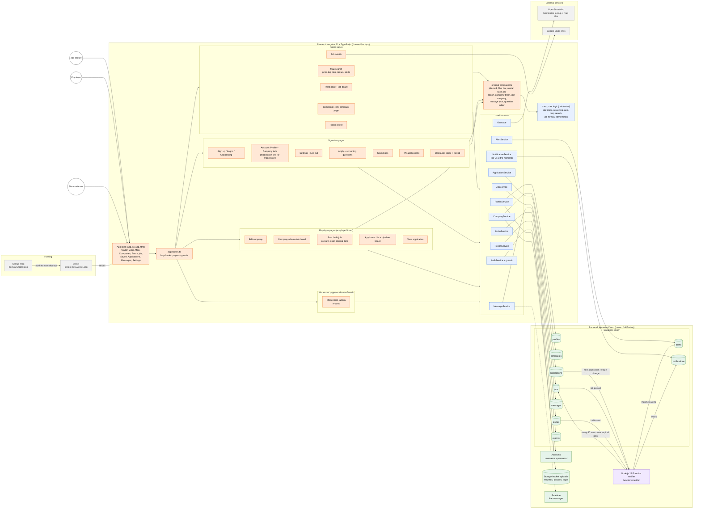

# JobTest architecture

How the pieces fit together. GitHub draws this diagram automatically; to edit it, change the
Mermaid code below (or paste it into https://mermaid.live to see changes live). Keep it in step
with the code — see "Keeping this diagram up to date" at the bottom.

- **People** use the website (orange), which is hosted on Vercel.
- **Pages** call **services** (blue); services read and write **Appwrite** (green).
- The **Node.js function** (purple) reacts to new rows and runs every hour.

## Where each box lives in the code

| Box | Code |
| --- | --- |
| App shell | `frontend/src/app/app.ts`, `app.html`, `app.scss` |
| app.routes.ts | `frontend/src/app/app.routes.ts` (guards in `core/auth.guards.ts`) |
| Pages | `frontend/src/app/pages/` — one folder or file per page |
| shared/ components | `frontend/src/app/shared/` |
| data/ pure logic | `frontend/src/app/data/` (tests: `*.spec.ts`) |
| core/ services | `frontend/src/app/core/` |
| Appwrite tables and bucket | Appwrite Console → JobTesting; recorded in `appwrite.json` |
| Node.js function | `functions/notifier/` (see `functions/README.md`) |

## Keeping this diagram up to date

When you add a page, service, table or function, add a box for it in the Mermaid code above
(copy a line in the same group) and an arrow for what it talks to. To regenerate it with an AI
tool instead, the prompt used originally is in the "JobTest Code Walkthrough" doc.
